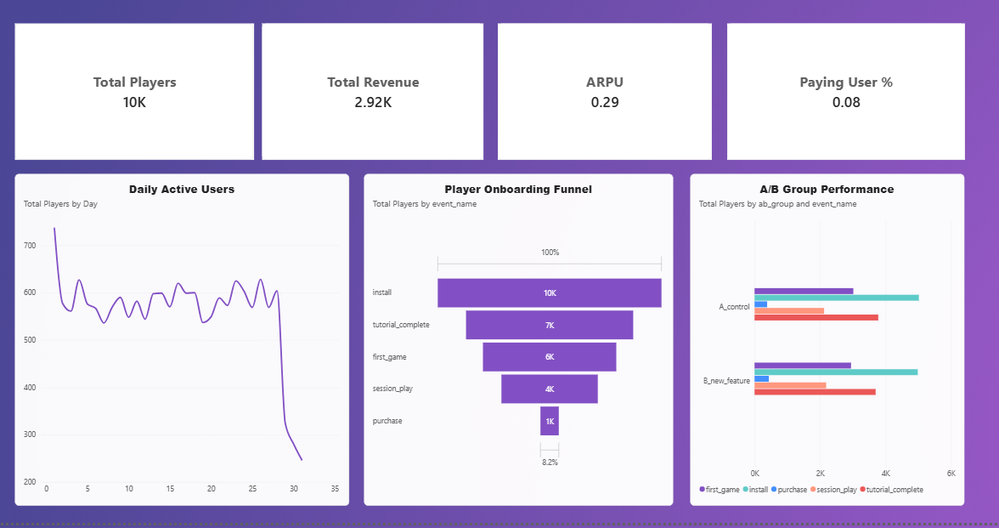

# Mobile Game Product Analytics: Player Retention, Funnel & A/B Testing

End-to-end product analytics project evaluating player engagement, onboarding conversion, and feature experimentation for a mobile puzzle game using **SQL**, **Python**, and **Power BI**.

## Project Overview
This project investigates player lifecycle behavior across acquisition, onboarding, retention, monetization, and live A/B experimentation:
* **Telemetry & Funnel Analytics:** Analyzed **30,733** player events across **10,000** unique installs to measure DAU/WAU/MAU, session duration, ARPU, and step-by-step onboarding conversion.
* **Cohort Retention Modeling:** Calculated Day 1, Day 7, and Day 30 retention rates alongside weekly player cohorts to identify early churn bottlenecks.
* **A/B Experimentation (`gate_30` vs. `gate_40`):** Evaluated **90,189** players in the Cookie Cats dataset to determine whether moving the first progression gate from Level 30 to Level 40 improves 7-day player retention.

## Project Structure
* `data/cookie_cats.csv` — 90,189 players A/B test dataset (Gate 30 vs Gate 40)
* `data/game_events.csv` — 30,733 player telemetry events (installs, tutorials, sessions, purchases)
* `SQL/player_metrics.sql` — DAU, WAU, MAU, New vs. Returning users, ARPU, Paying User %
* `SQL/retention.sql` — Day 1, Day 7, Day 30 retention & weekly cohort analysis
* `SQL/funnel.sql` — Install to Tutorial to First Game to Purchase conversion funnel
* `Python/ab_test.ipynb` — Hypothesis testing (Z-test), SRM check, 95% CI, power & bootstrap analysis
* `PowerBI/game_dashboard.pbix` — Interactive Power BI executive dashboard
* `PowerBI/dashboard_preview.png` — Dashboard preview

## Key Analytical Findings
* **Engagement & Monetization:** Across **10,000** tracked installs, overall paying conversion reached **8.20%** (**820** paying players) with **$2,915.34** total revenue (**$0.29 ARPU**) and an average session duration of **8.78 minutes**.
* **Retention & Churn:** Player retention measured **25.61% (Day 1)**, **14.53% (Day 7)**, and **5.34% (Day 30)**, highlighting the steepest drop-off between install and Day 1 onboarding.
* **A/B Experimentation (`gate_30` vs. `gate_40`):** Sample Ratio Mismatch (SRM) check confirmed a balanced split ($p > 0.01$). A two-proportion Z-test and 1,000-iteration bootstrap resampling on **90,189** players confirmed a statistically significant drop in 7-day retention when moving the progression gate from Level 30 (**19.02%**) to Level 40 (**18.20%**, $p < 0.01$).
* **Product Recommendation:** Keep the progression gate at **Level 30** to preserve 7-day player retention and prioritize Day 1 tutorial optimization to reduce early churn.

## Tools & Tech Stack
* **SQL (SQLite):** CTEs, date/time functions, cohort retention modeling, multi-stage funnel queries
* **Python:** `pandas`, `numpy`, `scipy`, `statsmodels`, `matplotlib`, `seaborn`
* **Power BI:** Custom DAX measures (`Total Players`, `Total Revenue`, `ARPU`, `Paying User %`), KPI cards, DAU time-series trend, onboarding funnel, and A/B comparison visuals

## How to Run
1. **SQL Queries:** Execute `SQL/player_metrics.sql`, `SQL/retention.sql`, and `SQL/funnel.sql` against `data/game_events.csv` using SQLite.
2. **Python A/B Test:** Open `Python/ab_test.ipynb` in VS Code or Jupyter and run all cells to reproduce the SRM check, Z-test, confidence intervals, statistical power, and bootstrap distribution chart.
3. **Power BI Dashboard:** Open `PowerBI/game_dashboard.pbix` in Power BI Desktop to explore interactive filters across player cohorts and A/B groups.